# </img> Waykeep: a sport tracker

_Waykeep_ is a privacy-respecting sport tracker for Android. It is a fork of [_OpenTracks_](https://codeberg.org/OpenTracksApp/OpenTracks).

> **Status:** under active development, not yet on F-Droid or Google Play.
> Build from source: `./gradlew :assembleIrreproducibleDebug`
> (flavor names in [`AGENTS.md`](AGENTS.md)).
> Bug reports and feature requests belong in the [Waykeep issue tracker](https://github.com/IntegerAlex/waykeep/issues).

  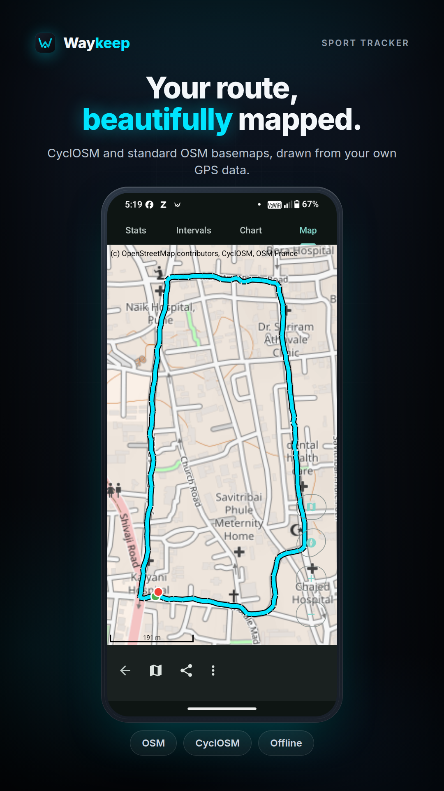
  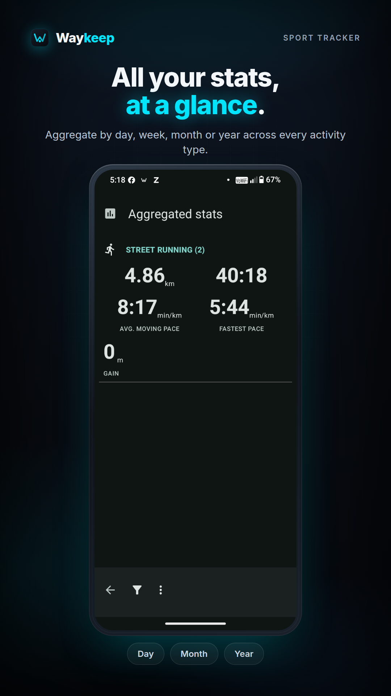
  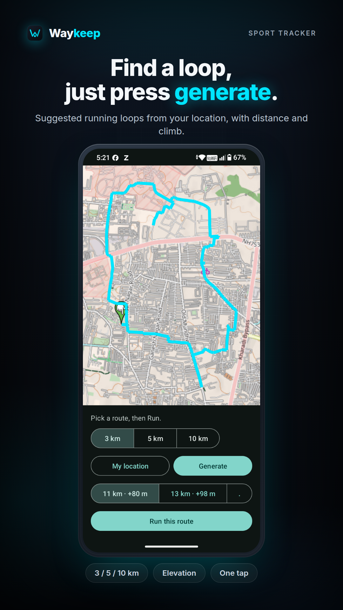

## Features

* **Tracking** with voice announcements, markers, and photos
* **Offline-capable in-app map** (CyclOSM by default, minimal canvas alternative, via [osmdroid](https://github.com/osmdroid/osmdroid)); viewed tiles are cached
* **Activity feed** with generated route thumbnails, stats, personal bests, monthly recap
* **Home-screen stats widget** (weekly/monthly totals)
* **Export** as KMZ 2.3 (incl. photos), KML 2.3, or GPX 1.1, manually or automatically after each recording
* **Altitude** gain/loss via barometer or BLE; **Bluetooth LE sensors** (HR, speed, cadence, power) — [tested sensors](README_TESTED_SENSORS.md)
* **Gadgetbridge** integration for live stats on wearables

## Screenshots

<table>
  <tr>
    <td align="center">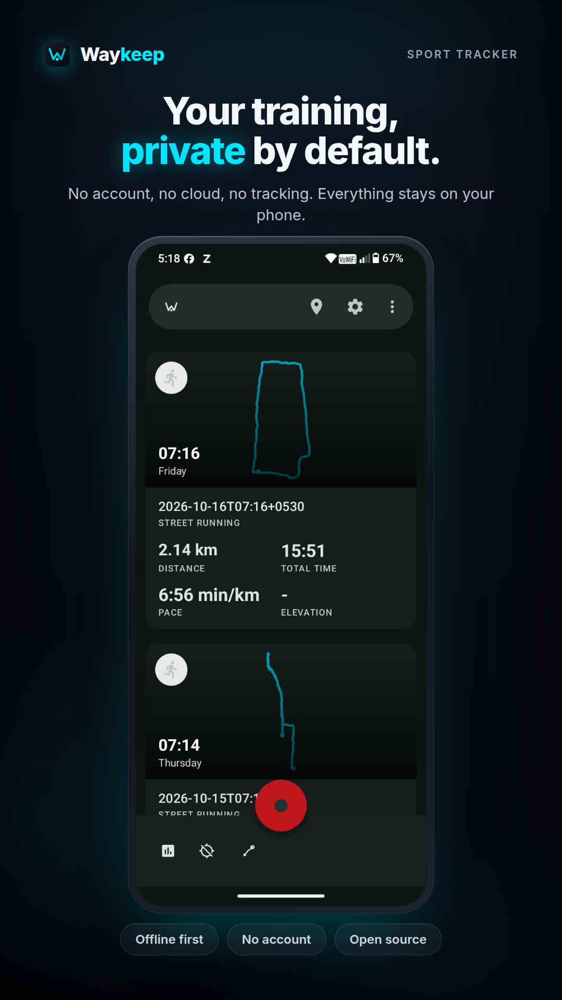 <b>Activity feed</b></td>
    <td align="center">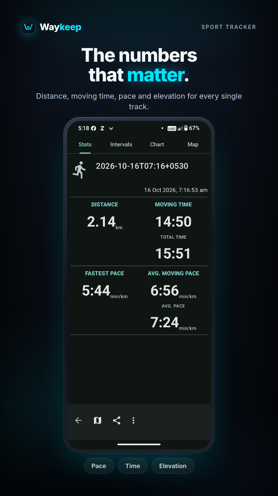 <b>Track statistics</b></td>
    <td align="center">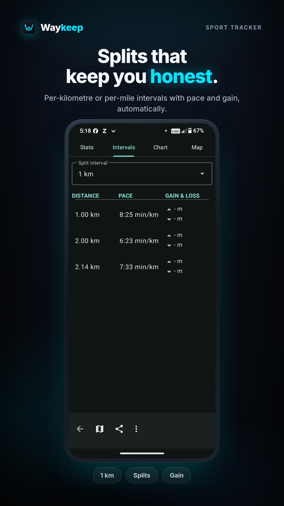 <b>Kilometre splits</b></td>
  </tr>
  <tr>
    <td align="center">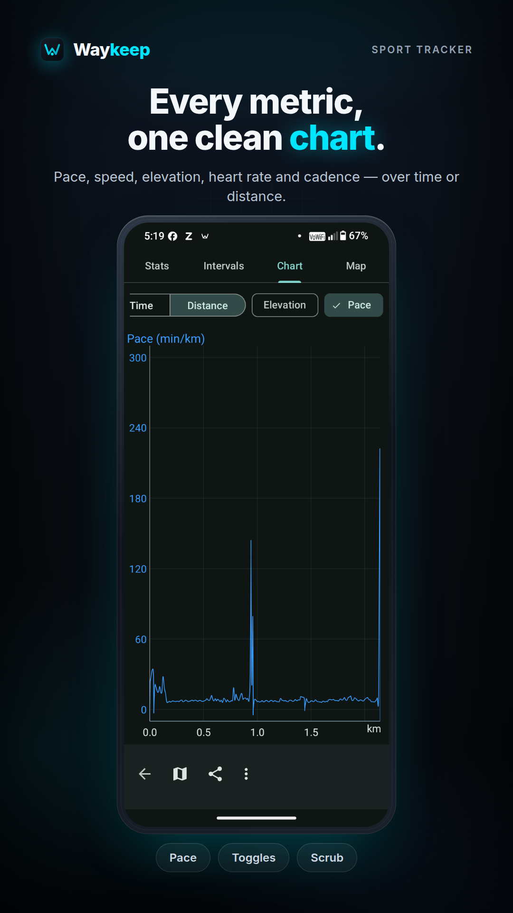 <b>Interactive charts</b></td>
    <td align="center">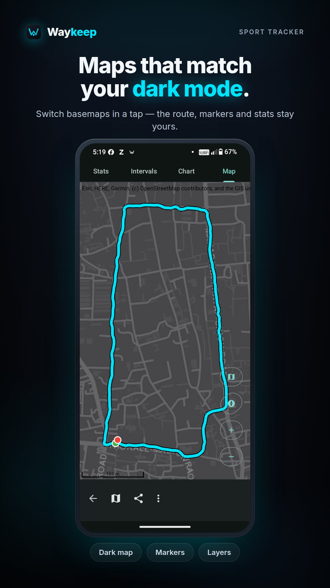 <b>Dark basemap</b></td>
    <td align="center">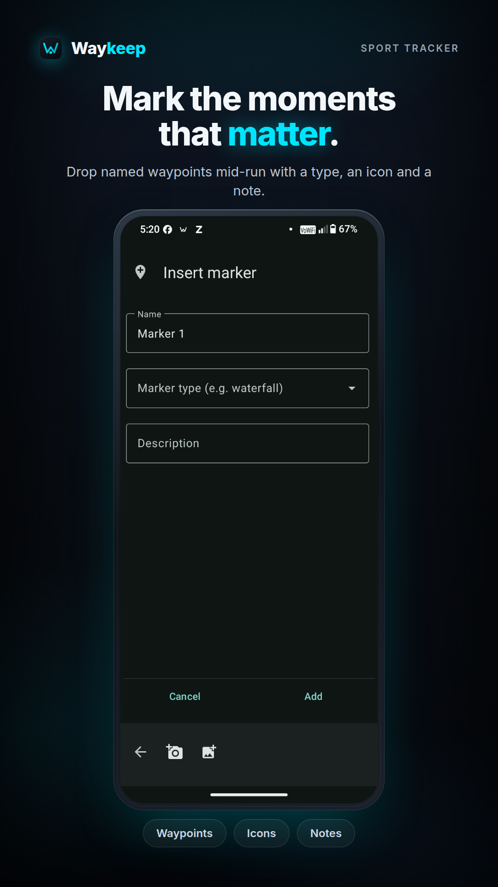 <b>Markers</b></td>
  </tr>
  <tr>
    <td align="center">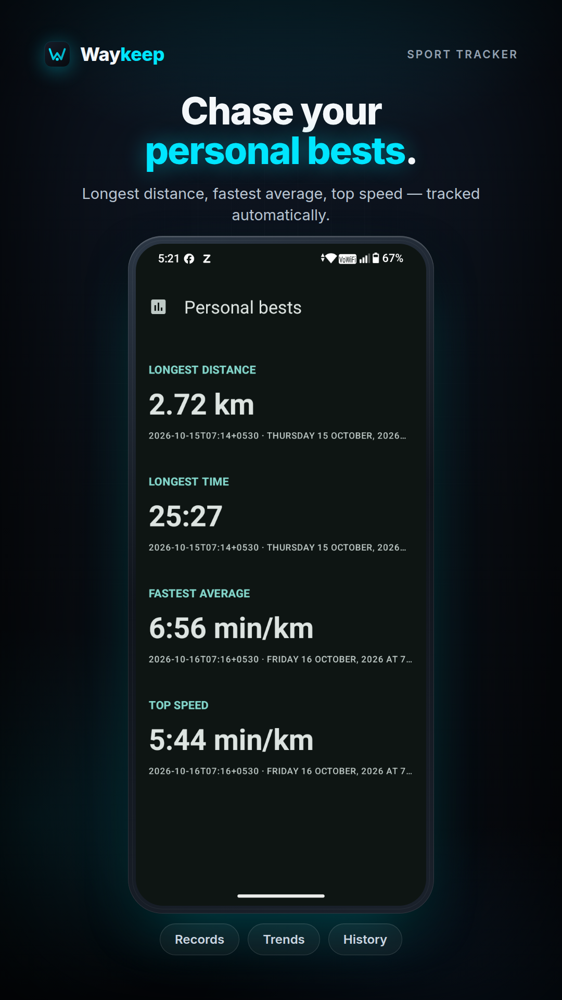 <b>Personal bests</b></td>
    <td align="center">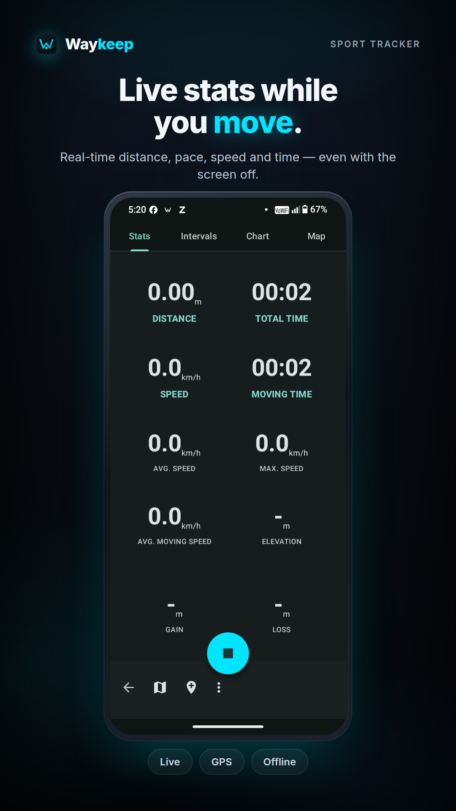 <b>Live recording</b></td>
    <td align="center">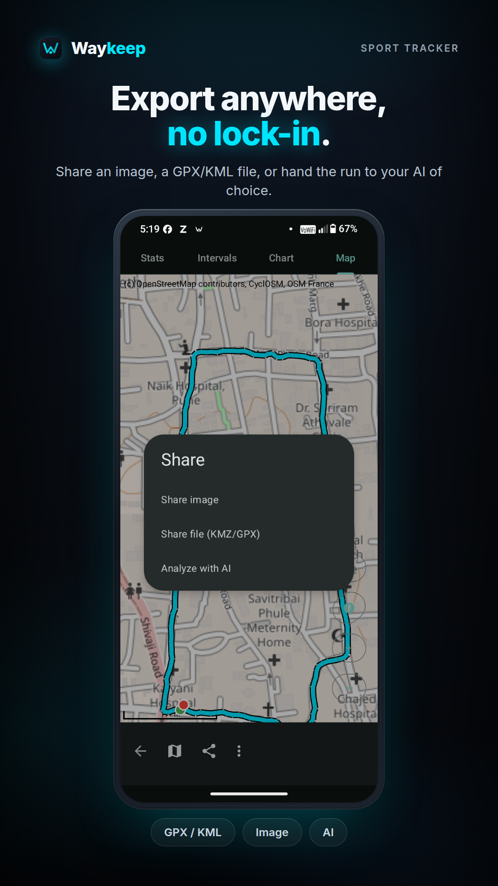 <b>Export &amp; share</b></td>
  </tr>
  <tr>
    <td align="center">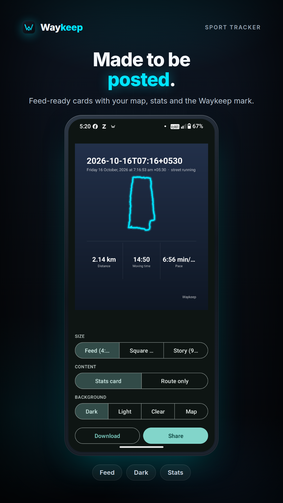 <b>Share cards</b></td>
    <td align="center">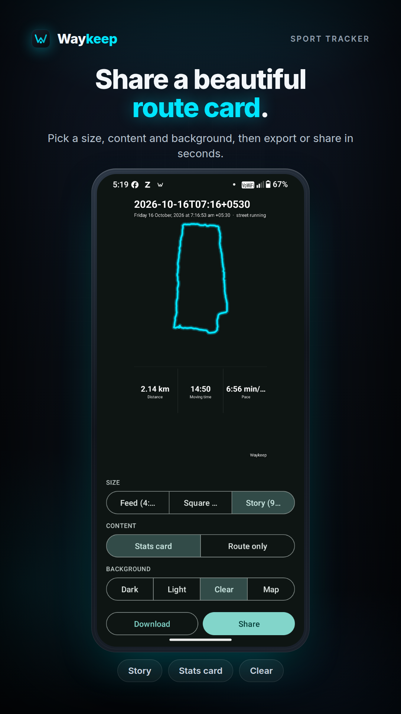 <b>Story format</b></td>
    <td align="center"></td>
  </tr>
</table>

## Privacy

No accounts, no ads, no analytics, no Google Play Services. Network is used only to fetch map tiles; nothing personal is uploaded.

**Permissions:** GPS (location), Internet (map tiles only), Bluetooth (optional sensors), foreground service (background recording).

## API & data

* **Public API** for start/stop/marker intents (disabled by default) and a **Dashboard API** for live external dashboards — details in [README_API.md](README_API.md).
* **Backup:** everything lives in app-internal storage; exporting one KMZ backs up all tracks and photos portably.

## History

A 2026 fork of [OpenTracks](https://codeberg.org/OpenTracksApp/OpenTracks) (itself from Google's discontinued _My Tracks_). Waykeep adds the in-app map, activity feed, widget, and brand, keeping the privacy posture. Upstream issues live on [Codeberg](https://codeberg.org/OpenTracksApp/OpenTracks/issues).

## License

Free software under [GPLv3](https://www.gnu.org/licenses/gpl-3.0.html); upstream-derived parts remain Apache 2.0. See [LICENSE](LICENSE), [LICENSE-APACHE-2.0](LICENSE-APACHE-2.0), [NOTICE](NOTICE), [RELICENSING.md](RELICENSING.md).
